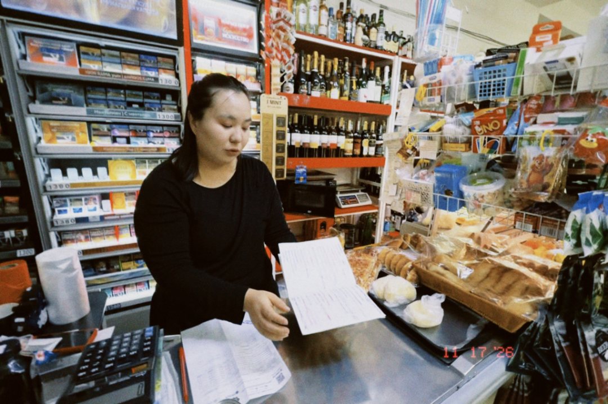
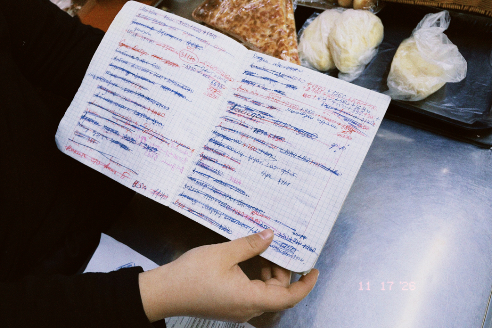

I've been running user interviews lately and wanted to share some notes from the last one. It's from the interview with the owner for the little shop in my courtyard, where we buy groceries all the time. 

Her notebook has no structure. Entries just go one after another. If a regular buys on credit again while they still owe, she finds their earlier line and adds the new amount to it. So every lookup means flipping back and forth through the pages.
- Most debts come back within a week
- When a new customer buys on credit for the first time, she writes down their phone number. She texts everyone reminders.
- When a notebook fills up, she copies all the unpaid debts into a new one by hand.
- What the shop owes its own suppliers is tracked separately, with invoices.

